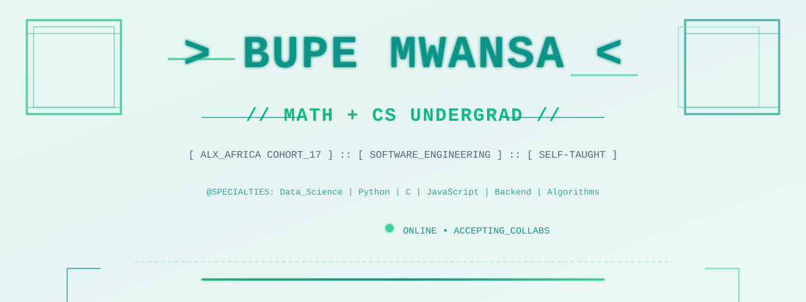

<picture>
  <source media="(prefers-color-scheme: dark)" srcset="assets/dark/header-enhanced-cyber-dark.svg">
  
</picture>

<a href="https://github.com/ProfessorMB21">
  <picture>
    <source media="(prefers-color-scheme: dark)" srcset="https://img.shields.io/badge/GITHUB-ProfessorMB21-ffffff?style=flat-square&logo=github&logoColor=0F172A">
    
  </picture>
</a>

<a href="mailto:profbupeeli@gmail.com">
  <picture>
    <source media="(prefers-color-scheme: dark)" srcset="https://img.shields.io/badge/EMAIL-profbupeeli@gmail.com-10B981?style=flat-square&logo=gmail&logoColor=ffffff">
    
  </picture>
</a>

---

### Activity Tracking

---

## 🚀 Currently Working On

- **Data Science & Machine Learning** — Building models and exploring AI/ML applications with Python
- **Backend Development** — Designing scalable systems with databases, APIs, and modern architectures
- **Mobile Development** — Learning Flutter & Jetpack Compose for cross-platform applications

---

## 🛠 Skills & Tech Stack

### 📝 Languages

### 🎨 Frontend & Mobile

### 🗄️ Databases & Backend

### 💻 Development Tools & Editors

### 🎮 Game Engines

### 🖥️ Operating Systems & Platforms

---

## 📊 GitHub Stats

Track my coding activity and contributions:

---

  🎨 Crafted by 💚 Ghosted 

